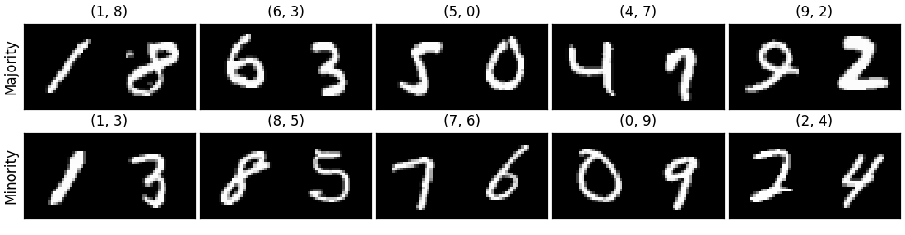

# Co-occurrence MNIST

A synthetic dataset for studying how conditional generative models handle
co-occurrence correlations between objects in an image. Each sample is a 1×2
grid (32×64 pixels) of two different MNIST digits. Five fixed digit pairs
co-occur far more often than any other pair, and the strength of that
correlation is controlled exactly.



*Top: the five majority pairs. Bottom: examples of minority pairs. Both
left–right orders of every pair occur equally often.*

## Dataset design

- **Majority pairs:** {1, 8}, {3, 6}, {5, 0}, {7, 4}, {9, 2}. Each digit has
  exactly one partner.
- **Minority pairs:** the other 40 pairs of different digits (80 counting both
  orders).
- **Correlation strength** ρ = P(partner of d | d) is the probability that a
  digit's partner appears in the same image given that the digit appears. It is
  identical for all ten digits, because every digit appears in the same number
  of minority samples.
- **ρ values:** `balanced` (ρ = 1/9, all 45 pairs equally likely, i.e. no
  correlation), 0.95, 0.98, 0.99 and 0.995.

For N images, the number of minority samples is M = 5 · round((1 − ρ) · N / 5),
and each majority pair gets (N − M) / 5 samples:

| ρ | Train: per majority pair | Train: minority |
|---|---|---|
| balanced (1/9) | 1,222 | 48,890 |
| 0.95 | 10,450 | 2,750 |
| 0.98 | 10,780 | 1,100 |
| 0.99 | 10,890 | 550 |
| 0.995 | 10,945 | 275 |

Every training split contains all 80 ordered minority pairs. The splits for
different ρ are nested: the minority samples at a larger ρ are a subset of
those at a smaller ρ, so the training sets differ only in how many minority
samples they contain.

## Splits

| Split | Images | Built from | Distribution |
|---|---|---|---|
| train | 55,000 per ρ | 55,000 MNIST train digits | correlation ρ |
| val | 5,000 per ρ | the other 5,000 MNIST train digits | same ρ as train |
| test | 22,500 | MNIST test digits | 250 per ordered pair: 2,500 majority, 20,000 minority |

The train and val digits are disjoint and stratified by digit class; their
indices are saved in `mnist_train_val_split.npz`.

**Minority test subsets.** FID, coverage and density depend on sample size, so
the 20,000 minority test images are split into 8 disjoint subsets of 2,500 (the
size of the majority test set). Each subset has 31 or 32 images of every ordered
minority pair and every digit exactly 500 times. To evaluate a model, generate
one image per test row using its `(d1, d2)`, compare against `test_maj.csv` for
the majority group, and against each `test_min_subset{k}.csv` for the minority
group, reporting the mean ± standard deviation over the 8 subsets.

## Folder layout

```
cooccurrence_1x2/
├── train/{maj,min}/<pair>/img_<idx>_<d1>_<d2>.png
├── val/{maj,min}/<pair>/...
├── test/{maj,min}/<pair>/...
├── metadata.csv                 one row per image
├── mnist_train_val_split.npz    MNIST train indices used for train and val images
├── splits/
│   ├── train_<ρ>.csv, val_<ρ>.csv   ρ in {balanced, 0.95, 0.98, 0.99, 0.995}
│   ├── test.csv, test_maj.csv
│   └── test_min_subset0.csv … test_min_subset7.csv
├── cell_classifier.pt           trained oracle
└── code/
    ├── make_dataset.py
    └── cell_classifier.py
```

`d1` is the left digit and `d2` the right digit. `<pair>` names the unordered
pair, e.g. both `(1, 3)` and `(3, 1)` are stored under `min/1_3/`.

**CSV columns** (`metadata.csv` and every split file):

| Column | Meaning |
|---|---|
| `idx` | unique image index |
| `path` | image path relative to the dataset root |
| `split` | `train`, `val` or `test` |
| `group` | `maj` or `min` |
| `pair` | unordered pair, e.g. `1_8` |
| `pool_order` | position within its generation pool (one pool per majority pair, one for minority); each train/val split takes the first n of every pool, with n set by ρ |
| `d1`, `d2` | left and right digit |
| `src1`, `src2` | MNIST index of each digit (train set for train/val rows, test set for test rows) |
| `subset` | minority test subset 0–7 (empty otherwise) |

## Generating the dataset

Python 3.10 was used. Install the requirements and download MNIST:

```bash
pip install -r requirements.txt
python -c "from torchvision.datasets import MNIST; [MNIST('data/mnist_raw', train=t, download=True) for t in (True, False)]"
```

Then build the dataset (about 135k PNGs, ~85 MB; a few minutes with 24 workers):

```bash
mkdir -p data/cooccurrence_1x2
python code/make_dataset.py --root data/cooccurrence_1x2 --mnist-root data/mnist_raw --workers 24
```

The seed is fixed (`--seed 0`), so the dataset is reproduced exactly. Use
`--overwrite` to rebuild an existing dataset.

## Oracle digit classifier

`cell_classifier.py` trains a small CNN on single 28×28 MNIST digits (the 55k
digits used for the training images), keeps the epoch with the best accuracy on
the 5k validation digits, and reports accuracy on MNIST test digits and on the
real test images:

```bash
python code/cell_classifier.py --root data/cooccurrence_1x2 --mnist-root data/mnist_raw
```

To score generated images, cut each image into its two cells and classify each
one separately, so the prediction for one cell never sees the other:

```python
from pathlib import Path
import torch
from cell_classifier import load_classifier, predict_cells, image_metrics

oracle = load_classifier(Path("data/cooccurrence_1x2/cell_classifier.pt"), torch.device("cuda"))
pred = predict_cells(oracle, images)      # images: [N, 1, 32, 64] in [0, 1]
metrics = image_metrics(pred, conditions) # conditions: [N, 2] requested (d1, d2)
```

`image_metrics` returns:

| Metric | Meaning |
|---|---|
| `cell_accuracy` | share of cells showing the requested digit |
| `image_accuracy` | share of images with both digits correct |
| `partner_leak_rate` | how often a requested digit's partner appears when it was not requested, e.g. (1, 3) generated as (1, 8) |
| `majority_pair_rate` | share of images recognized as a majority pair |

On the real test images the oracle reaches 99.6% cell accuracy and 99.2% image
accuracy in both groups, with a partner leak rate of 0.05% and a majority-pair
rate of 0.1% on minority images. Values at this level in generated images are
therefore oracle error, not model behavior.
